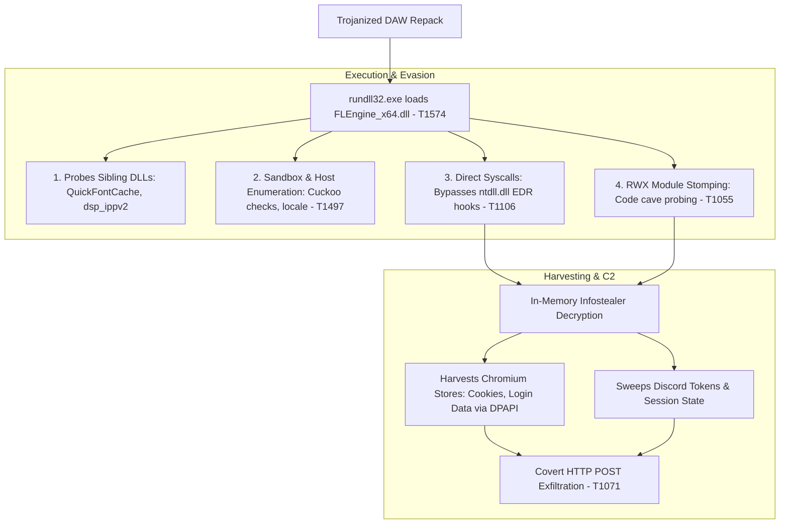

# Threat Analysis: Evasive In-Memory DLL Loader (`FLEngine_x64.dll`)

## Executive Summary
This report analyses an evasive commodity dynamic link library (`FLEngine_x64.dll`) delivered via a trojanised digital audio workstation (DAW) release. Despite achieving a **0/70 (Undetected)** static detection rating on VirusTotal, dynamic execution in the CAPE sandbox revealed an evasive in-memory loader. 

The binary deploys multi-stage evasion tactics, including direct kernel syscalls (`T1106`), Read-Write-Execute (RWX) memory stomping (`T1055`), and automated sandbox suppression (`T1497`) to bypass user-mode Endpoint Detection and Response (EDR) hooks before harvesting local browser credentials and session tokens.

---

## Sample Metadata

| Attribute | Value |
| :--- | :--- |
| **Filename** | `FLEngine_x64.dll` |
| **Original Application** | FL Studio Audio Engine (Trojanized) |
| **File Format** | PE32+ executable (DLL) (GUI) x86-64 |
| **File Size** | 26,907,128 bytes (~25.66 MB) |
| **MD5** | `60a4e5191250b2f4dbaf33c1bc11ca7b` |
| **SHA-1** | `295f97e514304345e431023a8d72063309aab1c2` |
| **SHA-256** | `85cc415bb094e8af2bb0bf27fb7d2021cdb9424c516be1f11282b57ee1ee5fdf` |
| **CRC32** | `3618943D` |
| **SSDEEP** | `196608:3SOxFpvMgzAG3hVw1AQK5SQQMMkw10dm5LENsyzkD1P:1dvMgEkE1A55SQQMC0w5LENsBpP` |
| **Authenticode Status** | `invalid-signature` (Original vendor signature broken by modifications) |
| **Static AV Score** | **0 / 70 Security Vendors Flagged** (Undetected across all engines) |

---

## MITRE ATT&CK Mapping

| Tactic | ID | Technique | Observed Mechanism / Telemetry Indicator |
| :--- | :--- | :--- | :--- |
| **Persistence / Escalation** | `T1574` | Hijack Execution Flow | Abuses DLL Search Order; loaded from untrusted user directories via `rundll32.exe`. |
| **Defense Evasion** | `T1106` | Native API | Executes direct assembly syscalls bypassing user-mode `ntdll.dll` API hooks. |
| **Defense Evasion / Escalation** | `T1055` | Process Injection | Loops failed allocations returning `CONFLICTING_ADDRESSES` (code cave hunting / module stomping). |
| **Defense Evasion** | `T1027` / `T1027.002` | Obfuscation / Packing | Packed binary structure with non-standard section headers, high entropy, and an appended overlay. |
| **Defense Evasion** | `T1497` | Virtualisation / Sandbox Evasion | Target thread suspension against Cuckoo Sandbox hooks; local time and timezone queries. |
| **Discovery** | `T1033` / `T1082` | System & User Discovery | Reads process tokens for UAC elevation; queries keyboard layouts and registry language keys. |
| **Command & Control** | `T1071` | Application Layer Protocol | Outbound HTTP traffic initiated directly, absent from standard monitor API logs. |

---

## Infection Vector & Execution Flow

### 1. Delivery & Execution Brokering (`T1574`)
The primary payload masquerades as `FLEngine_x64.dll`, the core runtime sound processing module of FL Studio. 
* Execution is brokered via the legitimate Windows binary `rundll32.exe`.
* Upon initialisaation, the loader scans the local workspace for authentic secondary application modules (`dsp_ippv2_x64.dll`, `QuickFontCache_x64.dll`, `Blend2D.dll`). By maintaining standard dependency loading, the process mimics authentic application startup while spawning secondary threads for payload orchestration.

### 2. Sandbox Evasion & Environmental Guardrails (`T1497`)
Before unpacking its core payload, the loader executes defensive heuristics:
* **Active Hook Suppression:** Enumerates active threads looking for monitoring instrumentation (specifically targeting Cuckoo Sandbox agent routines) and attempts thread suspension.
* **Geofencing & Time Verification:** Reads language subkeys, `tzres.dll.mui`, `sortdefault.nls`, and queries the local keyboard layout. It executes a timing verification loop comparing system tick counts; if an artificial or non-targeted environment is identified, execution halts silently.
* **Token Checks:** Queries token privileges to assess whether it operates in an elevated UAC context.

### 3. User-Mode Hook Evasion via Direct Syscalls (`T1106`)
Standard endpoint security agents monitor user-mode operations by placing inline trampolines (`JMP` hooks) into exported functions inside `ntdll.dll` (e.g., `NtAllocateVirtualMemory`). 
* This binary bypasses user-mode monitoring by resolving System Service Numbers (SSNs) and executing direct assembly `syscall` instructions.
* By jumping directly from the payload module into kernel space, memory allocation occurs without passing through `ntdll.dll`, leaving user-land API monitors blind to the staging phase.

### 4. Code Cave Probing & Module Stomping (`T1055`)
In the CAPE sandbox report, the loader generated repetitive allocation loops returning `CONFLICTING_ADDRESSES` across high-memory address space:
* Rather than allocating conspicuous, unbacked private memory ranges, the loader proactively sweeps loaded library modules for slack space ("code caves").
* It writes decrypted shellcode directly over benign sections of mapped DLLs (module stomping), disguising runtime memory calls as legitimate library activity.

---

## Defensive Engineering Analysis

### 1. The 0/70 Static Detection Blind Spot
The sample was evaluated across 70 antivirus vendors on VirusTotal, returning **0 detections**. This failure of static analysis highlights several key factors:
* **File Bloat:** At **25.66 MB**, the file exceeds standard static scan thresholds for many cloud-based scanners.
* **Authenticode Abuse:** While the file was flagged with an `invalid-signature`, signature breakage alone rarely triggers a high-severity static heuristic without a known malicious byte pattern.
* **Encrypted Overlay:** The actual malicious logic was stored in packed, high-entropy PE sections, remaining unreadable to signature engines until dynamic runtime unpacking.

### 2. Architectural Gap: Kernel-Mode Hardware-Enforced Stack Protection & HVCI
The persistence of in-memory evasion relies on gaps in OS-level memory protections:

#### The Default Windows Posture
On many consumer Windows 11 installations, **Kernel-mode Hardware-enforced Stack Protection** and **Memory Integrity (HVCI)** are set to **Off** by default. Microsoft often defers automatic activation due to legacy kernel-mode drivers (such as older anti-cheat modules, custom peripheral software, and motherboard utilities) that fail compatibility checks.

#### Attack Surface Exposed
* **Without HVCI:** The system does not strictly enforce **W^X (Write XOR Execute)** at the hypervisor level. The loader can freely allocate `RWX` memory pages and stomp existing module code.
* **Without Hardware-Enforced Stack Protection:** The system relies on software-based stack canaries (`/GS`). Canaries only prevent linear buffer overwrites; they provide zero protection against Return-Oriented Programming (ROP) gadgets, pointer hijacking, or direct jumps into stomped module caves.

#### Hardware-Enforced Mitigation (Intel CET / AMD Shadow Stack)
Enabling Kernel-mode Hardware-enforced Stack Protection leverages CPU microarchitecture (Intel 11th Gen+ / AMD Ryzen 5000+) to instantiate a hardware-isolated **Shadow Stack**:
* Every `CALL` instruction pushes return addresses to both the normal stack and the hardware-isolated shadow stack.
* Every `RET` instruction compares both targets.
* Any unauthorised control-flow jump (such as an in-memory ROP pivot or execution inside a stomped code cave) produces an immediate mismatch, triggering a hardware **Control Protection Exception (`#CP`)** that terminates the process before payload execution.

---

## Indicators of Compromise (IoCs)

### File Hashes
* **SHA-256:** `85cc415bb094e8af2bb0bf27fb7d2021cdb9424c516be1f11282b57ee1ee5fdf`
* **SHA-1:** `295f97e514304345e431023a8d72063309aab1c2`
* **MD5:** `60a4e5191250b2f4dbaf33c1bc11ca7b`

### Host Artifacts
* Staged dynamic link library: `FLEngine_x64.dll`
* Abused execution binary: `%SystemRoot%\System32\rundll32.exe`
* Target DLL probing artifacts:
  * `QuickFontCache_x64.dll`
  * `dsp_ippv2_x64.dll`
  * `Blend2D.dll`
