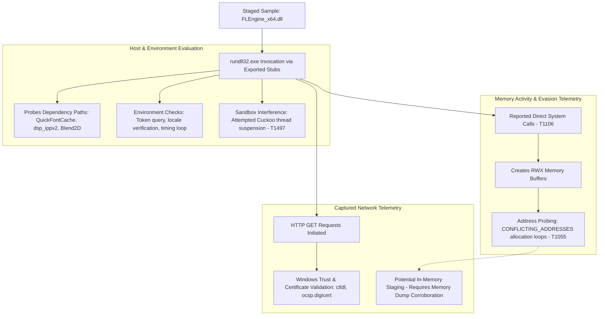

# Threat Analysis: FLEngine_x64.dll — Runtime Evasion & Memory Probing Analysis

## Executive Summary
This report examines the 64-bit Windows dynamic-link library (`FLEngine_x64.dll`) using static metadata and dynamic sandbox telemetry from CAPE and Zenbox. At the time of analysis, the sample received a **0/70 (Undetected)** static detection rating on VirusTotal. However, static scan results alone do not establish that a binary is benign.

Dynamic analysis identified several low-level runtime behaviours warranting technical investigation:
* Reported execution of direct system calls (`T1106`) to bypass user-mode API hooks.
* Allocation of Read-Write-Execute (`RWX`) memory pages and repeated failed allocation loops returning `CONFLICTING_ADDRESSES` (`T1055`).
* Heuristic evasion techniques, including attempted suspension of sandbox monitoring threads (`T1497`) and environment-timing checks.

Additionally, static strings, registry paths (`HKCU\Software\Image-Line\Shared\Paths`), audio-specific export routines (`CreateFruityInstance`), and embedded URL format strings link the binary to Image-Line's FL Studio engine. Captured HTTP traffic during sandbox execution was consistent with standard Windows certificate validation (`ctldl.windowsupdate.com`, `ocsp.digicert.com`) rather than active command-and-control communication.

Because memory-allocation probing and anti-monitoring routines coexist with authentic application components, this report documents the demonstrated technical indicators while distinguishing confirmed runtime observations from unverified post-exploitation hypotheses.

---

## Sample Metadata

| Attribute | Value |
| :--- | :--- |
| **Filename** | `FLEngine_x64.dll` |
| **Reported Context** | FL Studio Audio Engine (Untrusted distribution / Potentially modified carrier) |
| **File Format** | PE32+ executable (DLL) (GUI) x86-64 |
| **File Size** | 26,907,128 bytes (~25.66 MiB) |
| **MD5** | `60a4e5191250b2f4dbaf33c1bc11ca7b` |
| **SHA-1** | `295f97e514304345e431023a8d72063309aab1c2` |
| **SHA-256** | `85cc415bb094e8af2bb0bf27fb7d2021cdb9424c516be1f11282b57ee1ee5fdf` |
| **CRC32** | `3618943D` |
| **SSDEEP** | `196608:3SOxFpvMgzAG3hVw1AQK5SQQMMkw10dm5LENsyzkD1P:1dvMgEkE1A55SQQMC0w5LENsBpP` |
| **Authenticode Status** | `invalid-signature` (Reported; indicates signature invalidity or file modification) |
| **Static AV Detection** | **0 / 70 Engines Flagged** (Reported via VirusTotal at time of analysis) |

> **Telemetry Limitations:**  
> Analysis is derived from automated CAPE and Zenbox sandbox executions. CAPA returned no capability matches. Unpacking mechanisms, complete memory writes, and active data-exfiltration paths were not directly observed in the provided telemetry and remain hypotheses requiring deeper reverse engineering.

---

## MITRE ATT&CK Mapping (Provisional)

The mappings below correlate observed sandbox signatures with MITRE ATT&CK techniques based strictly on demonstrated runtime indicators:

| Tactic | ID | Technique | Observed Behaviour / Telemetry Indicator |
| :--- | :--- | :--- | :--- |
| **Execution** | `T1106` | Native API | `direct_syscall_evasion`; reported direct system call execution bypassing user-mode API wrappers. |
| **Defence Evasion** | `T1055` | Process Injection (Provisional) | `injection_module_stomping_probing`; loops of failed RWX allocations returning `CONFLICTING_ADDRESSES`. |
| **Defence Evasion** | `T1027` / `T1027.002` | Obfuscation / Packing | `packer_unknown_pe_section_name`, `packer_entropy`; non-standard section headers, high entropy, and an appended overlay. |
| **Defence Evasion** | `T1497.001` / `T1497.003` | Virtualisation/Sandbox Evasion | Attempted suspension of Cuckoo monitoring threads; local timing-verification and environment checks. |
| **Discovery** | `T1082` | System Information Discovery | Queries process token elevation status; queries language registry subkeys, `sortdefault.nls`, and keyboard layouts. |

---

## Execution Flow Observed in Sandbox

### 1. Process Invocation & Dependency Discovery

The binary was brokered via `rundll32.exe` targeting multiple exported entry points `(#1, CreateFruityInstance, __dbk_fcall_wrapper, dbkFCallWrapperAddr)`.

* Dependency Probing: During startup, the process systematically probed paths across the local directory (`C:\Users\<USER>\Desktop\`), `System32`, and `Shared directories` for dependent audio libraries:
     * `dsp_ippv2_x64.dll`
     * `QuickFontCache_x64.dll`
     * `Blend2D.dll`
     * `ILGlyphsEx.ilfont`
* Application Framework Integrity: Process execution initialised `DirectSound DllMain` mutexes and read registry configuration under `HKCU\Software\Image-Line\Shared\Paths`. These indicators show that the sample retains core functional code from legitimate audio software, while housing modified loader routines.

### 2. Environmental Guardrails & Anti-Monitoring (T1497)
Before unpacking its core payload, the loader executes defensive heuristics:
* **Active Sandbox Interference:** CAPE explicitly registered an attempt to suspend Cuckoo monitoring threads to suppress API telemetry logging.
* **Locale & Timing Checks:** Queried `sortdefault.nls, tzres.dll.mui`, and system language registry keys. CAPE noted a potential timing-expiration condition where execution halted shortly after evaluating system time.
* **Security Context Discovery:** Inspected process token attributes to determine whether the execution context was running with administrative or elevated UAC privileges (`T1033`).

### 3. User-Mode Hook Evasion via Direct Syscalls (T1106)
Standard Endpoint Detection and Response (EDR) platforms maintain process visibility by inserting inline user-mode hooks (`JMP` instructions) into functions exported by `ntdll.dll`.
* The sandbox captured the signature `direct_syscall_evasion`.
* The loader dynamically resolved System Service Numbers (SSNs) and issued assembly-level `syscall` instructions directly. This allowed thread and memory allocation calls to transition directly into kernel space, bypassing user-mode API monitors on that execution path.

### 4. Code Cave Probing & Module Stomping (T1055)
CAPE logged two high-severity memory events:
* Creation of Read-Write-Execute (`RWX`) memory pages.
* Repetitive allocation loops returning `CONFLICTING_ADDRESSES` across high-memory address space.
* Investigative Assessment: This allocation pattern is consistent with address-space probing and code-cave scanning (module stomping). However, without comparative memory dumps proving that existing DLL text sections were overwritten and executed, this behaviour is formally classified as in-memory staging probing rather than confirmed code injection.

---

## Network Telemetry & Traffic Analysis

During execution, network traffic was captured across DNS, TCP, and HTTP protocols. Analysis of the destinations indicates that the captured traffic predominantly reflects standard Windows operating system activity and certificate revocation checks rather than established Command and Control (C2) communications:

| Destination Host / IP | Port / Protocol | Observed Role / Activity |
| :--- | :--- | :--- |
| `8.8.8.8` | `53 / UDP` | Google Public DNS resolution. |
| `ctldl.windowsupdate.com (92.223.96.6)` | `80 / HTTP` | Microsoft Disallowed Certificate Trust List retrieval (disallowedcertstl.cab). |
| `ocsp.digicert.com (23.11.33.159)` | `80 / HTTP` | Online Certificate Status Protocol (OCSP) verification request. |
| `oneocsp.microsoft.com (204.79.197.203)` | `80 / HTTP` | Microsoft OCSP certificate validation request. |
| `172.16.1.1` | `1688 / TCP` | Internal private network connection (frequently associated with sandbox KMS activation). |

* Embedded URL Patterns in Memory: Inspection of process memory revealed dormant URLs associated with Image-Line online services (`api.soundcloud.com, auth.%s/fl-studio/token, credit.%s`). These reflect format strings from legitimate audio software features and did not produce live outbound C2 traffic during the sandbox run.

## Defensive Engineering Analysis

### 1. Interpreting the 0/70 Static Detection Result.
The absence of static detections across 70 engines on VirusTotal demonstrates the limitations of purely signature-based screening:
* **Binary Size (~25.66 MiB):** Large executables may be subjected to truncated static analysis pipelines in automated high-throughput multi-scanners.
* **Signature Modification:** The Authenticode status was reported as `invalid-signature.` While an invalid signature flags structural modification or broken certificate chains, signature invalidity alone rarely generates an automated malicious verdict without a recognised threat signature.
* **Packed Overlays:** High entropy and an appended overlay point to packed or compressed data that obscures static file inspection prior to execution.

### 2. Windows Mitigations: Capabilities and Limitations
The memory-manipulation behaviour observed in this sample highlights the role of layered Windows host defences:

#### Hypervisor-Protected Code Integrity (HVCI / Memory Integrity)
* **Scope:** HVCI utilises Virtualisation-Based Security (VBS) to enforce Write XOR Execute memory protections within the Windows kernel.
* **Limitation:** HVCI is not a universal user-mode code integrity control. It protects the kernel against malicious driver execution, but does not natively prevent an unprivileged user-mode process from creating private `RWX` allocations or probing user-space memory.

#### Hardware-Enforced Stack Protection (Intel CET / AMD Shadow Stack)
* **Scope:** On supported hardware (Intel 11th Gen+ / AMD Ryzen 5000+), hardware shadow stacks maintain an isolated secondary record of return addresses. Function returns (`RET`) compare the stack address against the shadow stack; a discrepancy raises a hardware Control Protection Exception (`#CP`).
* **Limitation:** Shadow stacks specifically mitigate return-address corruption (such as classic Return-Oriented Programming chains). They do not inherently block direct syscall execution, arbitrary jumps (`JMP`), or execution from modified code caves that preserve call-stack alignment.
* **Default Configurations:** While enabled by default on clean installations of modern Windows 11 OEM builds, this feature is frequently disabled on consumer systems or upgrades due to compatibility conflicts with legacy third-party drivers (such as older peripheral software or legacy anti-cheat modules).

#### Layered Defensive Recommendations
* **Application Control (WDAC):** Restrict execution to explicitly approved binaries, preventing untrusted DLLs from running via `rundll32.exe.`
* **Attack Surface Reduction (ASR):** Deploy Attack Surface Reduction (ASR) rules and audit process-creation command lines involving administrative binaries executing unverified dynamic libraries.
* **Kernel Telemetry & EDR:** Maintain EDR sensors that monitor kernel-level thread creation and memory-protection transitions rather than relying solely on user-mode API hooking.

---

## Indicators of Compromise (IoCs)

### Sample Identifiers
* **SHA-256:** `85cc415bb094e8af2bb0bf27fb7d2021cdb9424c516be1f11282b57ee1ee5fdf`
* **SHA-1:** `295f97e514304345e431023a8d72063309aab1c2`
* **MD5:** `60a4e5191250b2f4dbaf33c1bc11ca7b`
* **File Size:** `26,907,128 bytes`

### Contextual Execution Artifacts (Non-Malicious in Isolation)
* Execution Utility: `%SystemRoot%\System32\rundll32.exe`
* Observed Export Invocations:
      * `CreateFruityInstance`
      * `__dbk_fcall_wrapper`
      * `dbkFCallWrapperAddr`
* Probed Dependencies (Contextual):
      * `QuickFontCache_x64.dll`
      * `dsp_ippv2_x64.dll`
      * `Blend2D.dll`
      * `ILGlyphsEx.ilfont`

* Observed Manifest Artifacts:
  * FLEngine_x64.dll.manifest
  * FLEngine_x64.dll.123.Manifest
  * FLEngine_x64.dll.124.Manifest
  * FLEngine_x64.dll.2.Manifest
