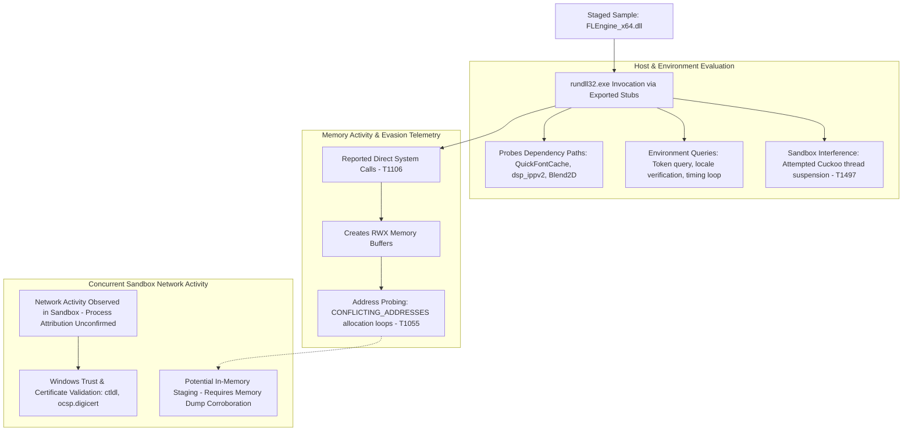

# Threat Analysis: FLEngine_x64.dll — Runtime Evasion & Memory Probing Analysis

## Executive Summary
This report examines the 64-bit Windows dynamic-link library (`FLEngine_x64.dll`) using static metadata and dynamic sandbox telemetry from CAPE and Zenbox. At the time of analysis (October 2026), the sample received a reported **0/70 (Undetected)** static detection rating on VirusTotal; however, static scan results alone do not establish that a binary is benign.

Dynamic analysis identified several low-level runtime behaviours warranting technical investigation:
- Reported behaviour consistent with direct system calls (`T1106`), which may bypass user-mode API monitoring hooks on the corresponding execution path.
- Allocation of Read-Write-Execute (`RWX`) memory pages and repeated failed allocation loops returning `CONFLICTING_ADDRESSES` (`T1055` — provisional).
- Heuristic evasion indicators, including attempted suspension of sandbox monitoring threads (`T1497` — provisional) and environment-timing queries.

Additionally, static strings, registry paths (`HKCU\Software\Image-Line\Shared\Paths`), audio-specific export routines (`CreateFruityInstance`), and embedded URL format strings link the binary to Image-Line's FL Studio engine. Captured HTTP traffic during sandbox execution was consistent with standard Windows certificate validation (`ctldl.windowsupdate.com`, `ocsp.digicert.com`); the available telemetry does not establish command-and-control communication or data exfiltration.

Because memory-allocation probing and anti-monitoring routines coexist with authentic application components, this report documents the demonstrated technical indicators while distinguishing confirmed runtime observations from unverified post-exploitation hypotheses.

---

## Sample Metadata

| Attribute | Value |
| :--- | :--- |
| **Filename** | `FLEngine_x64.dll` |
| **Reported Context** | Purported FL Studio audio engine; provenance and distribution source unverified. |
| **File Format** | PE32+ executable (DLL) (GUI) x86-64 |
| **File Size** | 26,907,128 bytes (~25.66 MiB) |
| **MD5** | `60a4e5191250b2f4dbaf33c1bc11ca7b` |
| **SHA-1** | `295f97e514304345e431023a8d72063309aab1c2` |
| **SHA-256** | `85cc415bb094e8af2bb0bf27fb7d2021cdb9424c516be1f11282b57ee1ee5fdf` |
| **CRC32** | `3618943D` |
| **SSDEEP** | `196608:3SOxFpvMgzAG3hVw1AQK5SQQMMkw10dm5LENsyzkD1P:1dvMgEkE1A55SQQMC0w5LENsBpP` |
| **Authenticode Status** | `invalid-signature` (Reported at time of analysis; indicates signature invalidity or file modification) |
| **Static AV Detection** | **0 / 70 Engines Flagged** (Reported via VirusTotal at time of analysis, October 2026) |

> **Telemetry Limitations:**  
> Analysis is derived from automated CAPE and Zenbox sandbox executions. CAPA returned no capability matches. Unpacking mechanisms, complete memory writes, process attribution for network traffic, and active data-exfiltration paths were not directly observed in the provided telemetry and remain hypotheses requiring deeper reverse engineering.

---

## MITRE ATT&CK Mapping (Provisional)

The mappings below correlate reported sandbox signatures with MITRE ATT&CK techniques based on demonstrated runtime indicators:

| Tactic | ID | Technique | Observed Behaviour / Telemetry Indicator |
| :--- | :--- | :--- | :--- |
| **Execution** | `T1106` | Native API (Reported) | `direct_syscall_evasion`; reported behaviour consistent with direct system calls bypassing user-mode API wrappers. |
| **Defence Evasion** | `T1055` | Process Injection (Provisional) | `injection_module_stomping_probing`; loops of failed RWX allocations returning `CONFLICTING_ADDRESSES`. |
| **Defence Evasion** | `T1027` | Obfuscated Files or Information | `packer_unknown_pe_section_name`, `packer_entropy`; non-standard section headers, high entropy, and an appended overlay. |
| **Defence Evasion** | `T1497` | Virtualisation/Sandbox Evasion (Provisional) | Attempted suspension of Cuckoo monitoring threads; local timing-verification and environment checks. |
| **Discovery** | `T1082` | System Information Discovery (Provisional) | Reported inspection of security tokens, language registry subkeys, `sortdefault.nls`, and keyboard layouts. |

---

## Execution Flow Observed in Sandbox

### 1. Process Invocation & Dependency Discovery

The binary was brokered via `rundll32.exe` targeting multiple exported entry points (`#1`, `CreateFruityInstance`, `__dbk_fcall_wrapper`, `dbkFCallWrapperAddr`).

* Dependency Probing: During startup, the process systematically probed paths across the local directory (`C:\Users\<USER>\Desktop\`), `System32`, and `Shared` directories for dependent audio libraries:
     * `dsp_ippv2_x64.dll`
     * `QuickFontCache_x64.dll`
     * `Blend2D.dll`
     * `ILGlyphsEx.ilfont`
* Application Context: Process execution initialised `DirectSound DllMain` mutexes and read registry configuration under `HKCU\Software\Image-Line\Shared\Paths`. These artifacts are consistent with Image-Line-related audio software. They do not establish the binary's provenance or demonstrate that any loader routines have been modified.

### 2. Environmental Guardrails & Anti-Monitoring (T1497)
During execution, the sandbox registered several defensive heuristics:
* **Active Sandbox Interference:** CAPE explicitly registered an attempt to suspend Cuckoo monitoring threads to suppress API telemetry logging.
* **Locale & Timing Checks:** Queried `sortdefault.nls`, `tzres.dll.mui`, and system language registry keys. CAPE noted a potential timing-expiration condition where execution halted shortly after evaluating system time.
* **Security Context Discovery:** Inspected process token attributes to check for administrative privileges or elevation status (`T1082`).

### 3. User-Mode Hook Evasion via Direct Syscalls (T1106)
Endpoint security agents typically monitor user-mode operations by inserting inline hooks (`JMP` instructions) into Windows native API wrappers in `ntdll.dll`.
* CAPE reported behaviour consistent with direct system calls `direct_syscall_evasion`.
* Such calls can bypass user-mode API hooks on the relevant execution path, but the exact implementation and effectiveness of the evasion were not independently verified. Kernel-level sensors, Event Tracing for Windows (ETW), and hypervisor monitors remain capable of detecting the resulting kernel transitions.

### 4. Memory-Allocation Probing (T1055)
CAPE recorded two reported memory behaviours:
* Creation of Read-Write-Execute (`RWX`) memory pages.
* Repetitive allocation loops returning `CONFLICTING_ADDRESSES` across high-memory address space.
* Investigative Assessment: While repeated allocation failures in high-memory ranges are consistent with address-space probing or scanning for module code caves, the available telemetry does not establish whether payload shellcode successfully overwrote mapped DLL text sections or executed. This behaviour is formally classified as memory-allocation probing pending physical memory dump analysis.

---

## Network Telemetry & Traffic Analysis

During execution, network traffic was captured across DNS, TCP, and HTTP protocols. Analysis of the destinations indicates that the captured traffic predominantly reflects standard Windows operating system activity and certificate revocation checks rather than established Command and Control (C2) communications:

| Destination Host / IP | Port / Protocol | Observed Role / Activity |
| :--- | :--- | :--- |
| `8.8.8.8` | `53 / UDP` | Google Public DNS resolution. |
| `ctldl.windowsupdate.com (92.223.96.6)` | `80 / HTTP` | Microsoft Disallowed Certificate Trust List retrieval (disallowedcertstl.cab). |
| `ocsp.digicert.com (23.11.33.159)` | `80 / HTTP` | Online Certificate Status Protocol (OCSP) verification request. |
| `oneocsp.microsoft.com (204.79.197.203)` | `80 / HTTP` | Microsoft OCSP certificate validation request. |
| `172.16.1.1` | `1688 / TCP` | Internal private network connection (frequently associated with sandbox KMS activation). |

* The supplied network records do not establish command-and-control communication. The memory-resident URL patterns (`api.soundcloud.com`, `auth.%s/fl-studio/token`, `credit.%s`) are consistent with application-related services, but their use during execution has not been demonstrated. Process attribution for individual network requests was not confirmed in the available summary.

---

## Defensive Engineering Analysis

### 1. Interpreting the 0/70 Static Detection Result
The absence of static detections across 70 engines on VirusTotal at the time of analysis demonstrates the limitations of purely signature-based screening:
* **Signature Modification:** The Authenticode status was reported as `invalid-signature`. While an invalid signature flags structural modification, corruption, or broken certificate chains, signature invalidity alone rarely generates an automated malicious verdict without a recognised threat signature.
* **Packed Overlays:** High entropy and an appended overlay point to packed or compressed data that obscures static file inspection prior to execution.

### 2. Windows Mitigations: Capabilities and Limitations
The memory-manipulation behaviour observed in this sample highlights the role of layered Windows host defences:

#### Hypervisor-Protected Code Integrity (HVCI / Memory Integrity)
* **Scope:** HVCI utilises Virtualisation-Based Security (VBS) to enforce kernel-mode code-integrity protections.
* **Limitation:** HVCI is not a universal user-mode code integrity control. It strengthens kernel code integrity against unsigned or untrusted kernel-mode code, but does not natively prevent an unprivileged user-mode process from creating private `RWX` allocations or probing user-space memory.

#### Hardware-Enforced Stack Protection (Intel CET / AMD Shadow Stack)
* **Scope:** On supported CPU architectures, hardware shadow stacks validate return-address integrity. Function returns (`RET`) verify that the data stack matches the CPU-isolated shadow stack, raising a Control Protection Exception (`#CP`) if a mismatch is detected.
* **Limitation:** Shadow stacks specifically mitigate return-address corruption (such as classic Return-Oriented Programming chains). They do not inherently block direct syscall execution, arbitrary jumps (`JMP`), or memory modifications that preserve call-stack integrity.

#### Layered Defensive Recommendations
* **Application Control (WDAC):** Restrict execution to explicitly approved binaries, a suitably configured WDAC policy can restrict unauthorised executable and DLL loading, subject to the policy's scope and enforcement settings.
* **Process & Script Monitoring:** Deploy Attack Surface Reduction (ASR) rules and audit process-creation command lines involving administrative binaries executing unverified dynamic libraries.
* **Kernel Telemetry & EDR:** Maintain EDR sensors that monitor kernel-level thread creation and memory-protection transitions rather than relying solely on user-mode API hooking.

---

## Indicators of Compromise (IoCs)

### Sample Identifiers
* **SHA-256:** `85cc415bb094e8af2bb0bf27fb7d2021cdb9424c516be1f11282b57ee1ee5fdf`
* **SHA-1:** `295f97e514304345e431023a8d72063309aab1c2`
* **MD5:** `60a4e5191250b2f4dbaf33c1bc11ca7b`
* **File Size:** `26,907,128 bytes`

### Contextual Execution Artifacts (Non-Malicious in Isolation)
* Execution Utility: `%SystemRoot%\System32\rundll32.exe`
* Observed Export Invocations:
      * `CreateFruityInstance`
      * `__dbk_fcall_wrapper`
      * `dbkFCallWrapperAddr`
* Probed Dependencies (Legitimate Application Modules):
      * `QuickFontCache_x64.dll`
      * `dsp_ippv2_x64.dll`
      * `Blend2D.dll`
      * `ILGlyphsEx.ilfont`

* Observed Manifest Artifacts:
  * `FLEngine_x64.dll.manifest`
  * `FLEngine_x64.dll.123.Manifest`
  * `FLEngine_x64.dll.124.Manifest`
  * `FLEngine_x64.dll.2.Manifest`
