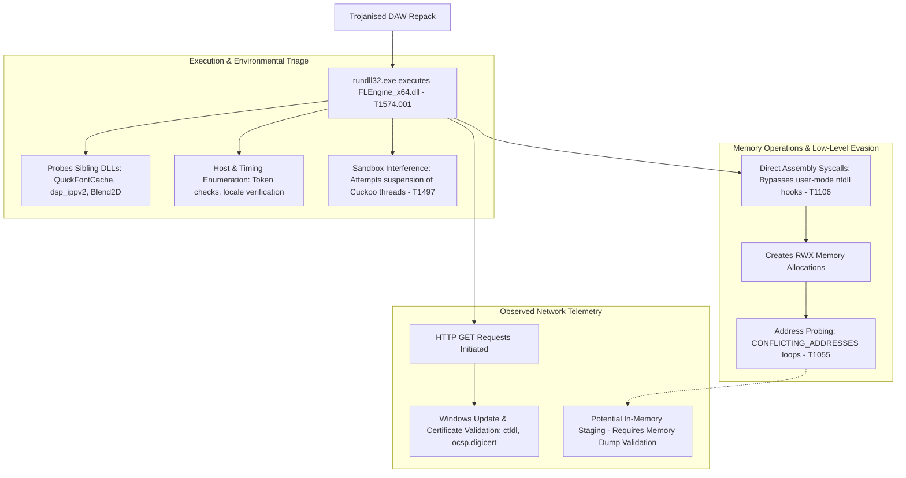

# Threat Analysis: Evasive In-Memory DLL Loader (`FLEngine_x64.dll`)

## Executive Summary
This report analyses a 64-bit Windows dynamic-link library (`FLEngine_x64.dll`) reportedly distributed within a trojanised digital audio workstation (DAW) release. Static multi-engine scanning on VirusTotal returned a **0/70 (Undetected)** rating at the time of analysis. However, behavioral analysis via the CAPE and Zenbox sandboxes revealed multiple indicators of defence evasion and low-level memory probing.

Dynamic execution identified direct system calls (`T1106`), Read-Write-Execute (RWX) memory allocations, automated sandbox-thread suspension routines (`T1497`), and repetitive allocation loops returning `CONFLICTING_ADDRESSES` (`T1055`). While the binary contains authentic application strings and export names associated with Image-Line's FL Studio engine, the combination of a broken Authenticode signature, anti-monitoring behaviour, and direct syscall execution points to a weaponised or trojanised carrier module.

This report documents the observed runtime indicators, separates demonstrated execution behavior from unverified payload hypotheses, and evaluates the capabilities and limitations of hardware-enforced Windows mitigations.

---

## Sample Metadata

| Attribute | Value |
| :--- | :--- |
| **Filename** | `FLEngine_x64.dll` |
| **Reported Context** | FL Studio Audio Engine (Trojanised Release / Masquerading) |
| **File Format** | PE32+ executable (DLL) (GUI) x86-64 |
| **File Size** | 26,907,128 bytes (~25.66 MiB) |
| **MD5** | `60a4e5191250b2f4dbaf33c1bc11ca7b` |
| **SHA-1** | `295f97e514304345e431023a8d72063309aab1c2` |
| **SHA-256** | `85cc415bb094e8af2bb0bf27fb7d2021cdb9424c516be1f11282b57ee1ee5fdf` |
| **CRC32** | `3618943D` |
| **SSDEEP** | `196608:3SOxFpvMgzAG3hVw1AQK5SQQMMkw10dm5LENsyzkD1P:1dvMgEkE1A55SQQMC0w5LENsBpP` |
| **Authenticode Status** | `invalid-signature` (Reported; indicates file tampering or modified digital signature) |
| **Static AV Score** | **0 / 70 Vendors Flagged** (Reported via VirusTotal at the time of submission) |

> **Analysis Scope & Limitations:**  
> The telemetry analyzed reflects dynamic sandbox execution logs (CAPE and Zenbox). While CAPE recorded behavioral signatures for memory probing and user-mode evasion, CAPA returned no static capability results. Hypotheses regarding post-exploitation payloads (such as credential access or active exfiltration) require further validation against live network captures and memory dumps.

---

## MITRE ATT&CK Mapping (Provisional)

The mappings below correlate observed sandbox signatures with MITRE ATT&CK techniques. Detections reflect observed execution attempts; successful execution across every technique remains subject to confirmation.

| Tactic | ID | Technique | Observed Behavior / Telemetry Indicator |
| :--- | :--- | :--- | :--- |
| **Defence Evasion** | `T1574.001` | DLL Search Order Hijacking | `dllload_suspicious_directory`; module loaded from user desktop via `rundll32.exe`. Probes multiple local and system paths. |
| **Defence Evasion** | `T1106` | Native API | `direct_syscall_evasion`; executes direct assembly system calls, bypassing user-mode `ntdll.dll` API hooks. |
| **Defence Evasion** | `T1055` | Process Injection | `injection_module_stomping_probing`; loops of failed RWX memory allocations returning `CONFLICTING_ADDRESSES`. |
| **Defence Evasion** | `T1027` / `T1027.002` | Obfuscated Files / Software Packing | `packer_unknown_pe_section_name`, `packer_entropy`; anomalous section headers, high entropy, and an appended overlay. |
| **Defence Evasion** | `T1497.001` / `T1497.003` | Virtualisation/Sandbox Evasion | Thread suspension targeting Cuckoo monitoring threads; environmental queries and timing-delay checks. |
| **Discovery** | `T1033` / `T1082` | System & User Discovery | Queries process token information for elevation status; queries registry language keys, `sortdefault.nls`, and keyboard layouts. |
| **Command and Control** | `T1071.001` | Web Protocols (Provisional) | HTTP requests initiated during analysis. Destination traffic correlates with certificate validation; payload C2 remains unconfirmed. |

---

## Infection Vector & Execution Flow

### 1. Delivery & Execution Context (T1574.001)
The binary was brokered via rundll32.exe targeting multiple exported entry points (#1, CreateFruityInstance, __dbk_fcall_wrapper, dbkFCallWrapperAddr).
* Dependency Probing: During startup, the process systematically probed paths across the local directory (C:\Users\<USER>\Desktop\), System32, and Shared directories for dependent audio libraries:
* dsp_ippv2_x64.dll
* QuickFontCache_x64.dll
* Blend2D.dll
* ILGlyphsEx.ilfont
* Legitimate Artifact Coexistence: Process execution initialized DirectSound DllMain mutexes and read registry configuration under HKCU\Software\Image-Line\Shared\Paths. These indicators show that the sample retains core functional code from legitimate audio software, while housing modified loader routines.

### 2. Environmental Guardrails & Anti-Monitoring (T1497)
Before unpacking its core payload, the loader executes defensive heuristics:
* **Active Sandbox Interference: CAPE explicitly registered an attempt to suspend Cuckoo monitoring threads to suppress API telemetry logging.
* **Locale & Timing Checks: Queried sortdefault.nls, tzres.dll.mui, and system language registry keys. CAPE noted a potential timing-expiration condition where execution halted shortly after evaluating system time.
* **Security Context Discovery: Inspected process token attributes to determine whether the execution context was running with administrative or elevated UAC privileges (T1033).

### 3. User-Mode Hook Evasion via Direct Syscalls (T1106)
Standard Endpoint Detection and Response (EDR) platforms maintain process visibility by inserting inline user-mode hooks (JMP instructions) into functions exported by ntdll.dll.
* The sandbox captured the signature direct_syscall_evasion.
* The loader dynamically resolved System Service Numbers (SSNs) and issued assembly-level syscall instructions directly. This allowed thread and memory allocation calls to transition directly into kernel space, bypassing user-mode API monitors on that execution path.

### 4. Code Cave Probing & Module Stomping (`T1055`)
CAPE logged two high-severity memory events:
* Creation of Read-Write-Execute (RWX) memory pages.
* Repetitive allocation loops returning CONFLICTING_ADDRESSES across high-memory address space.
* Investigative Assessment: This allocation pattern is consistent with address-space probing and code-cave scanning (module stomping). However, without comparative memory dumps proving that existing DLL text sections were overwritten and executed, this behaviour is formally classified as in-memory staging probing rather than confirmed code injection.

---

## Network Telemetry & Traffic Analysis

During execution, network traffic was captured across DNS, TCP, and HTTP protocols. Analysis of the destinations indicates that the captured traffic predominantly reflects standard Windows operating system activity and certificate revocation checks rather than established Command and Control (C2) communications:

| Destination Host / IP | Port / Protocol | Observed Role / Activity |
| :--- | :--- | :--- |
| 8.8.8.8 | 53 / UDP | Google Public DNS resolution. |
| ctldl.windowsupdate.com (92.223.96.6) | 80 / HTTP | Microsoft Disallowed Certificate Trust List retrieval (disallowedcertstl.cab). |
| ocsp.digicert.com (23.11.33.159) | 80 / HTTP | Online Certificate Status Protocol (OCSP) verification request. |
| oneocsp.microsoft.com (204.79.197.203) | 80 / HTTP | Microsoft OCSP certificate validation request. |
| 172.16.1.1 | 1688 / TCP | Internal private network connection (frequently associated with sandbox KMS activation). |

* Embedded URL Patterns in Memory: Inspection of process memory revealed dormant URLs associated with Image-Line online services (api.soundcloud.com, auth.%s/fl-studio/token, credit.%s). These reflect format strings from legitimate audio software features and did not produce live outbound C2 traffic during the sandbox run.

##Defensive Engineering Analysis

### Hypervisor-Protected Code Integrity (HVCI / Memory Integrity)
The absence of static detections across 70 engines on VirusTotal highlights common blind spots in signature-based screening:
* **Binary Bloat (~25.66 MiB): Files exceeding standard heuristic inspection limits are frequently processed through truncated analysis pipelines to preserve cloud scanning throughput.
* **Signature Modification:** The Authenticode status was flagged as `invalid-signature.` While signature invalidity alerts analysts to file tampering, it rarely generates an automated high-severity malware verdict without an existing byte signature.
* **Packed Overlays:** High-entropy section data and appended overlays obscure payload intent until unpacked dynamically in memory.

### 2. Windows Mitigations: Capabilities and Limitations
The evasive memory techniques observed in this sample highlight the critical role of layered host configurations. However, security controls must be understood within their actual operating boundaries:

#### Hypervisor-Protected Code Integrity (HVCI / Memory Integrity)
* **Scope:** HVCI uses Virtualisation-Based Security (VBS) to enforce Write XOR Execute page protections strictly within kernel mode.
* **Limitation:** HVCI is not a universal user-mode code integrity control. While critical for protecting the kernel against vulnerable drivers (BYOVD), it does not natively prevent user-space processes from allocating private RWX memory or performing user-mode module stomping.

#### Hardware-Enforced Stack Protection (Intel CET / AMD Shadow Stack)
* **1:** Application Control (WDAC): Enforce Windows Defender Application Control policies to prevent unsigned or invalidly signed binaries from executing via rundll32.exe.
* **2** Attack Surface Reduction (ASR): Enable rules blocking execution of obfuscated scripts and child processes spawned from common administrative binaries.
* **3** Kernel Telemetry & EDR: Maintain endpoint sensors that correlate kernel-level process creation and thread-injection telemetry (e.g., Microsoft-Windows-Threat-Intelligence ETW) rather than relying exclusively on user-mode ntdll.dll API hooks.

#### Recommended Layered Controls
Enabling Kernel-mode Hardware-enforced Stack Protection leverages CPU microarchitecture (Intel 11th Gen+ / AMD Ryzen 5000+) to instantiate a hardware-isolated **Shadow Stack**:
* Every `CALL` instruction pushes return addresses to both the normal stack and the hardware-isolated shadow stack.
* Every `RET` instruction compares both targets.
* Any unauthorised control-flow jump (such as an in-memory ROP pivot or execution inside a stomped code cave) produces an immediate mismatch, triggering a hardware **Control Protection Exception (`#CP`)** that terminates the process before payload execution.

---

## Indicators of Compromise (IoCs)

### File Hashes
* **SHA-256:** `85cc415bb094e8af2bb0bf27fb7d2021cdb9424c516be1f11282b57ee1ee5fdf`
* **SHA-1:** `295f97e514304345e431023a8d72063309aab1c2`
* **MD5:** `60a4e5191250b2f4dbaf33c1bc11ca7b`

### Host & Execution Artifacts
* Staged File: `FLEngine_x64.dll`
* Execution Utility: `%SystemRoot%\System32\rundll32.exe`
* Probed Dependencies (Contextual):
  * `QuickFontCache_x64.dll`
  * `dsp_ippv2_x64.dll`
  * `Blend2D.dll`
  * `ILGlyphsEx.ilfont`

* Observed Manifest Artifacts:
  * FLEngine_x64.dll.manifest
  * FLEngine_x64.dll.123.Manifest
  * FLEngine_x64.dll.124.Manifest
  * FLEngine_x64.dll.2.Manifest
